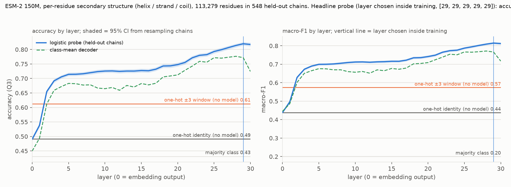
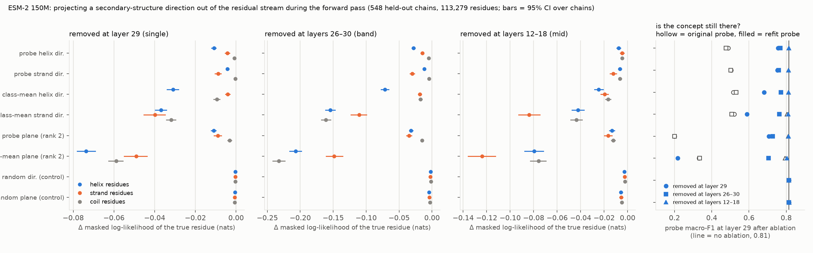
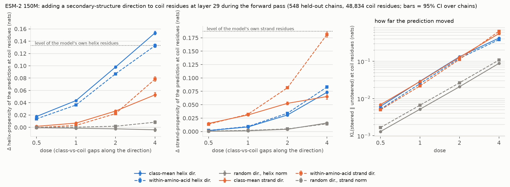

# esm2-probe-ablation

**A protein language model's residual stream decodes secondary structure. Is that direction load-bearing for what the model itself predicts?**

The same loop as [probe-monitor-control](https://github.com/LGOICOUR/probe-monitor-control),
run on a biological model with a ground truth whose answer is known. Model:
**ESM-2 150M** (`facebook/esm2_t30_150M_UR50D`, 30 layers, width 640), run locally
on an M-series Mac. Label: per-residue **three-state secondary structure**
(helix / strand / coil, DSSP-derived) on 548 PDB chains. Loop: (1) record the
residual stream at every layer for every labelled residue; (2) fit a linear probe
per layer, scored only on held-out chains, next to baselines that use no model;
(3) at the best layers, project the probe's direction out of the residual stream
*during the forward pass*, with a random direction as control, and measure what
the model's own masked-residue predictions lose; (4) refit a probe on the ablated
activations to ask whether the direction was the concept or one line through it;
(5) add the direction back to coil residues, in doses, and ask whether the model's
predicted chemistry moves the way the biology says.

This is a research exercise on a small open model, not a tool. Nothing here has
been reviewed by anyone but the agent that built it (see "How this was built").

## Headline



**Decodable.** A logistic probe on the residual stream reads three-state
secondary structure at **0.820 accuracy [0.814, 0.826]** (macro-F1 0.815
[0.809, 0.820]) at layer 29, the layer every training fold chose on its own.
All numbers are on held-out chains (5 chain-grouped folds); 95% CIs resample
the 548 chains.

| reader | accuracy | macro-F1 |
|---|---|---|
| majority class (coil) | 0.431 [0.423, 0.440] | 0.201 [0.198, 0.204] |
| one-hot residue identity, no model | 0.491 [0.486, 0.497] | 0.439 [0.434, 0.444] |
| one-hot ±3-residue window, no model | 0.612 [0.606, 0.619] | 0.574 [0.569, 0.580] |
| **probe on ESM-2 150M, layer chosen inside training (29)** | **0.820 [0.814, 0.826]** | **0.815 [0.809, 0.820]** |
| class-mean (nearest-centroid) decoder, best layer (28) | 0.776 | 0.772 |

The layer-0 probe lands exactly on the identity baseline (0.491), as it must:
ESM-2's embedding output is a function of the residue alone (positions enter
inside attention). Accuracy is 0.72 by layer 5, flat through layer 17, then
climbs to the top of the network; layer 30 is a hair below 29.

**Load-bearing, but weakly, and through the class-mean geometry rather than
the probe's own direction.** For each held-out fold, a direction fit on the
training chains is projected out of every residue's residual vector during the
forward pass, and the model's masked prediction of each residue is re-read
(8 masking passes per chain, every residue masked once). Change in the masked
log-likelihood of the true residue, by the residue's true class, with a random
direction as control. Baseline: −1.958 nats, top-1 39.2%.



| direction removed | layers | Δ log-lik., helix residues | strand residues | coil residues | refit probe at 29 (baseline 0.81) |
|---|---|---|---|---|---|
| probe's helix direction | 29 | **−0.011** [−0.012, −0.010] | −0.004 | −0.001 | 0.76 |
| probe's strand direction | 29 | −0.004 | **−0.009** [−0.010, −0.007] | −0.000 | 0.75 |
| class-mean helix direction | 29 | **−0.031** [−0.034, −0.028] | −0.004 | −0.009 | 0.68 |
| class-mean strand direction | 29 | −0.037 | −0.040 [−0.045, −0.035] | −0.032 | 0.59 |
| probe's plane (rank 2) | 29 | −0.011 | −0.009 | −0.003 | 0.71 |
| class-mean plane (rank 2) | 29 | −0.074 | −0.049 | −0.059 | **0.22** (0.56 at layer 30) |
| random direction (control) | 29 | −0.000 [−0.001, −0.000] | −0.000 | −0.000 | 0.81 |
| probe's helix direction | 26–30 | **−0.028** [−0.030, −0.026] | −0.015 | −0.005 | 0.77 |
| probe's strand direction | 26–30 | −0.012 | **−0.030** [−0.033, −0.027] | −0.005 | 0.76 |
| class-mean helix direction | 26–30 | **−0.072** [−0.077, −0.066] | −0.018 | −0.018 | 0.77 |
| class-mean strand direction | 26–30 | −0.154 | −0.111 | −0.161 | 0.76 |
| probe's plane (rank 2) | 26–30 | −0.032 | −0.035 | −0.015 | 0.73 |
| class-mean plane (rank 2) | 26–30 | −0.207 | −0.148 | −0.233 | 0.70 |
| random direction (control) | 26–30 | −0.002 | −0.002 | −0.002 | 0.81 |
| probe's plane (rank 2) | 12–18 | −0.013 | −0.017 | −0.012 | 0.81 |
| class-mean plane (rank 2) | 12–18 | −0.080 | −0.124 | −0.076 | 0.80 |

Full table with every CI, top-1 change rates and the original-probe column:
[`results/p4/esm2_t30_150M/summary.md`](results/p4/esm2_t30_150M/summary.md).

- **A double dissociation, small and clean.** The probe's helix direction hurts
  helix residues about three times more than strand residues and leaves coil
  alone; its strand direction does the reverse; the random direction does
  nothing (CIs are ten times tighter than the effects, on 113k residues). Over
  five layers the targeted-class effect grows to −0.03 nats and the dissociation
  holds. So the decoded direction is used by the model for the class it
  decodes, but the model leans on it very lightly: 0.01 nats at one layer on a
  −1.96 baseline, with 7% of top-1 predictions changing.
- **The class-mean direction moves the model two to four times more than the
  probe's direction** for the same class and scope (cosine between the two
  0.66 for helix, 0.61 for strand), the same ordering as in probe-monitor-control
  and Arditi et al. The helix one is specific; the strand one is not (over
  layers 26–30 it costs coil −0.16, helix −0.15, strand −0.11): it is largely
  the stream's top principal component (cosine 0.60), and a random direction
  of the same size and spectrum does 60% of its damage (follow-up below).
- **A line, not the concept.** After any single direction is removed, a probe
  refit on the ablated activations still decodes at 0.68–0.77 (baseline 0.81),
  and even after the probe's whole rank-2 plane is gone, 0.71–0.73. The
  class-mean plane is different: removing it at one layer makes the three
  class-conditional means coincide there, so by the LEACE result (Belrose et
  al. 2023) no linear reader can beat a constant predictor at that layer, and
  the refit reads 0.22 (chance 0.20). The next layer rebuilds part of it (0.56
  at layer 30), and the model's output loses only 0.06 nats. Linear erasure of
  the concept at one layer costs the model six times what erasing the probe's
  plane costs (−0.07 vs −0.01), and still little.
- **Mid-network removal is recomputed.** After removing either plane at layers
  12–18, a probe at layer 29 reads 0.81 again, and even the *original*
  clean-trained probe does, so the late representation is rebuilt in the same
  directions; the output still loses up to 0.12 nats for the class-mean plane,
  which the final secondary-structure representation does not explain.

Reading, in one sentence: in ESM-2 150M secondary structure is cleanly
decodable, the decoded direction is causally used for the right class, nearly
all of what the model actually reads lives in the class-mean geometry, not in
the probe's weight vector, and adding that geometry to a coil residue makes the
model predict helix or strand chemistry there in the amounts the biology says
(the sufficiency block below).

**Follow-up: is what the probe reads *beyond* the class-mean direction used?**
The probe direction and the class-mean direction overlap (cosine 0.66 helix,
0.61 strand), so the rows above cannot say whether the model reads the probe's
own information or only the part the two share. Split each direction into its
component along the other and the unit remainder orthogonal to it, and remove
the remainder alone: "probe's helix direction, class-mean part removed" is the
probe's helix weight vector minus its component along the class-mean helix
direction. Pre-registered in `DECISIONS.md`; full table with CIs in
[`results/p4/esm2_t30_150M_perp/summary.md`](results/p4/esm2_t30_150M_perp/summary.md).

| direction removed | layers | Δ log-lik., helix residues | strand residues | coil residues | refit probe at 29 (baseline 0.81) |
|---|---|---|---|---|---|
| probe's helix direction, class-mean part removed | 29 | −0.002 [−0.003, −0.002] | −0.003 | −0.001 | 0.79 |
| probe's strand direction, class-mean part removed | 29 | −0.008 | −0.008 | −0.009 | 0.78 |
| class-mean helix direction, probe part removed | 29 | **−0.010** [−0.011, −0.008] | −0.003 | −0.006 | 0.81 |
| class-mean strand direction, probe part removed | 29 | −0.042 | −0.034 | −0.037 | 0.81 |
| random direction (control) | 29 | −0.000 | −0.000 | −0.000 | 0.81 |
| probe's helix direction, class-mean part removed | 26–30 | −0.009 | −0.009 | −0.004 | 0.80 |
| probe's strand direction, class-mean part removed | 26–30 | −0.018 | −0.017 | −0.033 | 0.79 |
| class-mean helix direction, probe part removed | 26–30 | **−0.032** [−0.035, −0.029] | −0.012 | −0.010 | 0.81 |
| class-mean strand direction, probe part removed | 26–30 | −0.195 | −0.118 | −0.220 | 0.81 |
| random direction (control) | 26–30 | −0.002 | −0.002 | −0.002 | 0.81 |

What the probe reads beyond the class-mean direction is not used by the model.
The helix remainder costs helix residues 0.002 nats (the full probe direction
0.011, the class-mean direction 0.031) with no specificity; the strand
remainder costs 0.008 on every class alike, the signature of variance removed
rather than of strand information. The probe's direction is the sharper
separator (d' 2.7 against 1.75 for the class-mean direction, on held-out
residues; `scripts/check_variance.py`) with a third of its variance: a
discriminative probe points toward a low-variance direction where the classes
separate cleanly, and the model's output is insensitive to that direction. The
remainder of the class-mean helix direction, by contrast, still carries helix
signal (d' 1.15) and still costs helix residues specifically. The strand
class-mean direction and its remainder are the two highest-variance single
directions (3.5% and 4.5% of the layer's variance) and the most damaging,
equally for every class.

**Is that damage just the size of the perturbation?** The random control
carries 0.18% of the variance, so a second control draws random directions
tilted toward the layer's high-variance axes until they carry the same share
as a class-mean direction, per fold and layer (`variance_matched_random`;
pre-registered in `DECISIONS.md`; table with CIs in
[`results/p4/esm2_t30_150M_vm/summary.md`](results/p4/esm2_t30_150M_vm/summary.md)).
Layer 29's top eigenvector holds 7.3% of the variance, and the strand
class-mean direction is largely that axis (cosine 0.60, its remainder 0.71);
the matched randoms reproduce the loading (0.61, 0.71).

| random direction matched in variance to | layers | Δ log-lik., helix residues | strand residues | coil residues | refit probe at 29 |
|---|---|---|---|---|---|
| class-mean helix direction (1.6%) | 29 | −0.009 | −0.007 | −0.008 | 0.80 |
| class-mean strand direction (3.5%) | 29 | −0.022 | −0.018 | −0.024 | 0.80 |
| strand remainder (4.5%) | 29 | −0.036 | −0.036 | −0.044 | 0.80 |
| class-mean helix direction (1.6%) | 26–30 | −0.046 | −0.045 | −0.038 | 0.79 |
| class-mean strand direction (3.5%) | 26–30 | −0.083 | −0.079 | −0.099 | 0.80 |
| strand remainder (4.5%) | 26–30 | −0.133 | −0.104 | −0.141 | 0.80 |

Size explains the unspecific effects and not the specific ones. A random
direction of the strand remainder's size and spectrum does the same damage at
layer 29 (class-averaged ratio 1.03; 14–16% of top-1 predictions change in
both) and 70% of it over five layers; one of the strand class-mean direction's
size does 60% of its damage at both scopes, so about 40% of that direction's
effect is not size. One of the helix class-mean direction's size costs helix
residues a third of what the helix direction costs (−0.009 vs −0.031) while
costing the other classes as much or, over five layers, more (−0.045 vs
−0.018): the helix effect is signal. Even the class pattern of the unspecific
damage follows the geometry: over five layers both the strand class-mean
direction and its matched random hit strand residues least and coil most.

**Sufficiency: adding the direction makes the model predict the right
chemistry.** Everything above removes a direction and asks what the model
loses. The converse adds one. The class-mean helix direction is added to the
residual vector of every coil residue at layer 29 during the forward pass, in
doses of the helix-vs-coil gap along the direction (d = 1 moves the coil
residues' mean coordinate onto the helix mean's: a 34-unit, two-SD step on a
residual of norm 255), and the model's masked prediction at those residues is
scored by amino-acid propensity, the log-ratio of each amino acid's frequency
in helices to its overall frequency, computed on the fold's training chains,
which reproduces the Chou–Fasman table (A, E, L, Q, M, R, K helix formers;
V, I, Y, F, W, C, T strand formers; P, G, N, D, S coil formers). The strand
direction, a within-amino-acid version of each direction (the control for
composition: 28% of the helix direction and 45% of the strand direction lie in
the span of the 20 amino-acid means, so a plain class-mean direction could
simply inject "Ala-like" at the masked position), and a random direction of
the same norm are run the same way. Pre-registered in `DECISIONS.md`; tables
with every CI in
[`results/p5/esm2_t30_150M/summary.md`](results/p5/esm2_t30_150M/summary.md).



| direction added at coil residues | dose | Δ helix-propensity | Δ strand-propensity | helix–coil gap closed | strand–coil gap closed | KL from unsteered | Δ log-lik., coil |
|---|---|---|---|---|---|---|---|
| class-mean helix | 1 | **+0.044** [+0.042, +0.045] | +0.008 | **0.33** [0.31, 0.34] | 0.05 | 0.029 | −0.049 |
| class-mean helix | 2 | +0.098 | +0.031 | 0.74 | 0.16 | 0.133 | −0.181 |
| class-mean helix | 4 | +0.153 | +0.073 | 1.15 | 0.39 | 0.422 | −0.526 |
| class-mean strand | 1 | +0.007 | **+0.031** [+0.030, +0.032] | 0.05 | **0.17** [0.15, 0.18] | 0.029 | −0.039 |
| class-mean strand | 2 | +0.027 | +0.053 | 0.20 | 0.28 | 0.129 | −0.151 |
| class-mean strand | 4 | +0.053 | +0.065 | 0.40 | 0.35 | 0.558 | −0.570 |
| within-amino-acid helix | 1 | +0.036 | +0.009 | 0.27 | 0.05 | 0.025 | −0.043 |
| within-amino-acid helix | 4 | +0.133 | +0.083 | 1.00 | 0.44 | 0.384 | −0.495 |
| within-amino-acid strand | 1 | +0.003 | +0.032 | 0.02 | 0.17 | 0.022 | −0.030 |
| within-amino-acid strand | 4 | +0.078 | +0.181 | 0.59 | 0.97 | 0.646 | −0.668 |
| random, helix norm | 1 | −0.001 | +0.001 | −0.01 | 0.01 | 0.005 | −0.005 |
| random, strand norm | 1 | +0.000 | +0.002 | 0.00 | 0.01 | 0.007 | −0.008 |
| random, helix norm | 4 | −0.004 | +0.016 | −0.03 | 0.08 | 0.088 | −0.088 |
| random, strand norm | 4 | +0.008 | +0.014 | 0.06 | 0.08 | 0.108 | −0.111 |

- **The direction is sufficient, and the chemistry is right.** At one gap the
  prediction at coil residues moves a third of the way to what the model
  predicts at its own helix residues: alanine +1.7, leucine +1.2, glutamate
  +1.0, glutamine +0.7, arginine +0.5 percentage points of predicted
  probability; glycine −1.8, proline −1.3, serine −0.8, threonine −0.6,
  asparagine −0.4. The strand direction raises valine +1.3, isoleucine +0.6,
  threonine, phenylalanine and cysteine, and lowers aspartate, proline,
  glycine, lysine and glutamate. The direction was fit from class labels
  alone. A random direction of the same norm does 2–7% of the shift.
- **Not injected identity.** The within-amino-acid directions, which carry no
  composition difference by construction, keep 83% of the helix effect and
  all of the strand effect at one gap, and the within-amino-acid strand
  direction is the better strand direction at higher doses (0.97 of the gap
  at four gaps, against 0.35 for the plain direction, which saturates): the
  composition part of the plain strand direction, largely the stream's top
  principal component, is not what the output reads as strand.
- **Super-linear, then saturating or overshooting.** Doubling the dose
  multiplies the effect by 2.0–2.5 up to two gaps. At four gaps the strand
  direction saturates and the helix direction overshoots (1.15 of the gap:
  coil residues predicted more helix-like than real helix residues), at a
  cost of 0.5 nats per coil residue, with 56–61% of top-1 predictions changed.
- **Specific but not exclusive.** The other class's propensity rises too, at
  a fifth (helix direction) to a quarter (strand direction) of the targeted
  one at one gap, because both directions move mass off the coil formers and
  part of it onto the hydrophobic residues that helices and strands share;
  the ratio worsens with dose.
- **Mostly local.** Steering coil residues costs the helix and strand residues
  of the same chains 6–8% of what it costs the coil residues under the helix
  direction; under the strand direction the real strand residues lose 41% as
  much (0.016 against 0.039 nats), the one place the steering reaches beyond
  the steered positions. The original layer-30 probe calls 84% of the steered
  coil residues helix (layer 29: 94%): the next layer passes the injected
  signal on.

**Where this sits in the literature.** Steering a protein language model
along structure-related directions is not new, and neither is the read-out.
[InterPLM](https://arxiv.org/abs/2412.12101) (Simon & Zou, 2024; Nature
Methods 2025) clamps sparse-autoencoder features in ESM-2 and reads the
model's softmax at masked positions, with a periodic-glycine feature as the
worked example; [Villegas Garcia & Ansuini (2025)](https://arxiv.org/abs/2502.09135)
steer ESM-2 8M with sparse-autoencoder latents toward zinc-finger domains;
[Banerjee et al. (2025)](https://arxiv.org/abs/2507.06458) steer generation by
neuron activation toward properties that include alpha helices;
[Huang et al. (2025)](https://arxiv.org/abs/2509.07983) add difference-of-means
vectors, the construction used here, to ESM2, ESM3 and ProLLaMA for
thermostability and solubility; the off-manifold collapse that strong
guidance produces ([2026](https://arxiv.org/abs/2608.18597)) is what the
four-gap rows above show in miniature; [FoldSAE (2026)](https://arxiv.org/abs/2511.22519)
steers secondary-structure formation with a tunable dose, in RFdiffusion.
Sparse-autoencoder features for secondary structure in ESM-2 are described
by [Adams et al. (2025)](https://proceedings.mlr.press/v267/adams25a.html)
and [Gujral et al. (2025)](https://www.pnas.org/doi/10.1073/pnas.2506316122).
On the method side, the decodable-versus-causal loop and the refit-probe
check have a recent literature of their own
([Refit the Probe, 2026](https://arxiv.org/abs/2606.00926);
[Dissociating Decodability and Causal Use, 2026](https://arxiv.org/abs/2604.22128))
next to the references already cited. What this repo adds, as far as an
abstract-level search on 2026-10-29 could tell, is the per-residue,
position-matched version with a class-mean direction; the dose in natural
units, with its dose–response and overshoot; the composition-controlled
direction as the identity-injection control (the nearest precedent is a
composition-preserving shuffle baseline for family signals,
[NeurIPS 2025](https://neurips.cc/virtual/2025/130747)); and the paired,
pre-registered necessity and sufficiency tests on one direction with random
and variance-matched controls. Those are increments in rigor and framing, not
a new phenomenon. The search read abstracts and snippets only; a closer
preprint could exist.

## After the plane: what a linear erasure leaves, and what the model uses (P6-P10)

Added 2026-11-05 to 2026-11-06. Each block is one question, with its control. Numbers are
macro-F1 on held-out chains or the change in masked log-likelihood of the true residue
(nats; 0.06 nats is about 6%), 95% CIs resampling chains. Full tables in each `results/pN/`
folder; the decision log has the pre-registered guesses.

**P6, is the concept gone, or only its linear part?** Post hoc on the P2 recording: the fold's
class-mean plane is projected out of layer 29, then readers are refit on the edited rows
(chain-grouped cv). Linear reads 0.22 (floor 0.20). A small MLP reads 0.79, an RBF SVM 0.78,
QDA (one mean and one full covariance per class) **0.81**, the unedited ceiling. A
squares-only logistic reader (axis-aligned ellipsoids, no cross terms) reads 0.56. So after a
perfect linear erasure the class survives entirely in the *shape* of each class's cloud
(its covariance), with the tilt of the ellipsoids carrying most of it. Random plane: 0.81
for every reader. `results/p6/`.

**P7, does the next layer rebuild from the row or from its neighbours?** The plane is removed
at layer 29 at a random fraction p of each chain's positions during the forward pass. A
probe refit on the ablated rows at layer 30 reads 0.56 when every position is ablated,
0.66 when both +-1 neighbours are intact, 0.69 when all +-3 are intact; never back to 0.81.
Layer 29 at ablated rows stays 0.22-0.26 whatever the neighbours. Model loss at ablated
rows: -0.040 with intact neighbours vs -0.062 with all ablated; intact rows beside ablated
ones lose -0.013. Random plane: 0.81 and 0.000 everywhere. `results/p7/`.

**P8, erase the shape too: does the model use it?** Quadratic erasure as a forward-pass
intervention: after the plane, each class's cloud is mapped onto the pooled covariance by
the optimal-transport (Bures) map between Gaussians, the same construction as QLEACE
(Belrose et al. 2025), applied here at labelled positions with the true label (unlabelled
positions get the plane only). Control: the same maps applied with shuffled labels (moves
rows further, erases nothing). Model loss: plane **-0.063 (6%)**, plane + shape **-0.103
(10%)**, shuffled **-0.081 (8%)**; by class the shape costs helix about 4 points over its
control, strand 2.5, coil **0**. Layer-30 linear rebuild: 0.59 after the plane, 0.49 after
plane + shape, 0.62 shuffled, so the next layer reads the shape a little. Two caveats that
anyone copying this will hit. (1) Per-fold second-order maps make a cross-validated QDA
score *below the floor* (0.03): a fold's test rows are mapped by maps fit without them,
its training rows by maps whose fit set contained the test fold, and the covariance
sampling noise is anti-correlated between the two. `--disjoint-fit` fits the maps once on
folds 0-2 and reads on folds 3-4. (2) Finite-sample erasure leaves a consistent fingerprint
on new chains: one plane fit on 60% of chains leaves a linear reader at 0.41 on the other
40% (0.22 under per-fold cv), and the quadratic maps leave QDA at 0.76 (not 0.20). The
model, trained on UniRef, cannot read that fingerprint; refit readers can. The model-loss
numbers replicate across both designs. `results/p8/` and `results/p8/*_disjoint/`.

**P9, where is the plane used?** The plane removed at one layer at a time, model loss only,
beside P3's decodability at that layer. Cost about 1% through layers 2-13 (where a probe
already reads 0.70), rising to 6% at layer 29 and **14% at layer 30**, where nothing
downstream can rebuild it (coil 20%). Composition control (the within-amino-acid class-mean
plane from P5, which carries no amino-acid-identity difference by construction): layer 1's
10% is composition entirely; at 29 the structure-proper cost is 4.9%; at 30 it is **7.6%**
(coil 11.7%, strand 1.4%). Random planes cost nothing at any layer.
`results/p9/` and `results/p9/*_strat/`, figure `results/p9/esm2_t30_150M/sweep.png`.

**P10, sequential multi-layer erasure.** P4's band condition fit every plane on the
unedited recording; once the planes below are removed the class means at the next layer
move, and a pre-fit plane there is stale (P4's band left a refit reader at 0.70 at layer 30).
P10 fits each layer's plane on activations already edited by the planes below it, so the
plane is gone at every layer of the band (layer-30 linear refit 0.23 for every band, the
floor; stale 0.54-0.74). Model loss, sequential vs stale vs random: band 29-30 **-0.146** /
-0.160 / -0.001, the same as layer 30 alone, so removing at 29 adds nothing once 30 is
removed; band 26-30 **-0.334 (28%)** / -0.205 / -0.004; band 20-30 **-0.713 (51%, top-1
39% -> 19%)** / -0.327 / -0.013. QDA at layer 30 still reads 0.74-0.81 after every band:
the shape is never touched. The composition control (the same bands with the within-amino-acid class-mean plane,
fit sequentially; `_strat`) splits structure from amino-acid identity: **-0.058 (6%)** for
29-30, **-0.128 (12%)** for 26-30, **-0.405 (33%, top-1 28%)** for 20-30, so roughly half
of each plain sequential cost is identity and the rest is structure that the model keeps
re-deriving layer after layer. That plane is only ~0.9 aligned with the full class-mean
plane, so a linear reader at 30 keeps 0.38-0.41 after it; QDA stays 0.74-0.81.
`results/p10/`.

## Caveats, what did not work first

- **The effect sizes are small.** The strongest single-direction effect at the
  read-out layer is 0.03 nats on a −1.96 baseline; the probe's own direction
  moves the output by 0.01. "Separated from the random control" is not "the
  model depends on it". The whole class-mean plane over five layers (−0.15 to
  −0.23 nats, ~40% of top-1 predictions change) is the only ablation here that
  visibly degrades the model. The steering test reads larger in relative
  terms (one gap at one layer closes a third of the helix–coil difference in
  predicted chemistry), but that difference is itself 0.13 nats of expected
  log-propensity, one to two percentage points of probability per amino acid.
- **The pre-registered sizes were wrong; the directions held.** Before the run
  (DECISIONS.md) the agent predicted −0.02 to −0.10 nats for one direction at
  layer 29 (got −0.011 / −0.009 for the probe directions, −0.031 for the
  class-mean helix direction), −0.1 to −0.3 for the late band (got −0.03 for
  probe directions, −0.07 to −0.15 for class-mean), and that the probe's plane
  would hurt every class by −0.2 to −0.5 (got −0.03: wrong by ten times). All
  seven predictions held qualitatively; three missed quantitatively. The
  steering test's five predictions (2026-10-29) held in their headline parts
  and missed in five details, two of them in the direction opposite to the
  earlier misses: the model-level propensity gap is smaller than the
  composition-level one, not larger, and the other class's score rises rather
  than falls.
- **Stacked projections with clean-fit directions do not add up.** After the
  class-mean plane is projected out of layers 26–28, the clean-fit plane at 29
  no longer equalizes the class means there (refit 0.70, against 0.22 when 29
  is ablated alone): upstream ablation moves the class means off the clean
  plane. A real multi-layer erasure must refit on the ablated stream layer by
  layer; the band numbers here understate what a cumulative erasure would do.
- **The strand class-mean direction is not clean.** It hurts all three classes
  about equally, so "class-mean directions are more load-bearing" is partly
  "class-mean directions carry more than the concept".
- **The read-out layer is near the top (29 of 30)**, so "load-bearing" at the
  single layer is close to "read by the LM head"; the 12–18 scope is what shows
  that an earlier removal is recomputed. The same holds for the steering test:
  adding a direction at layer 29 is close to adding it at the head's input, so
  the precise claim is that the output reads the class-mean direction as helix
  or strand chemistry, not that earlier computation uses it that way. Steering
  at a mid layer was not run.
- **The masked read-out is an approximation.** Masking every 8th residue per
  pass sits 0.022 nats below the exact one-residue-per-pass PLL on six test
  chains (top-1 agreement 87%); every condition uses the identical schedule, so
  the differences are fair, but the absolute PLLs are slightly pessimistic and
  per-residue values are noisy (mean |difference| 0.17 nats). Effects are
  therefore reported only as class means with chain-resampled CIs.
- **Folds are grouped by chain, not by family.** Homologous chains can sit on
  both sides of a fold, and ESM-2 saw these sequences in training (UniRef), so
  the probe accuracy is an upper bound on family-held-out generalization. The
  ablation does not depend on this.
- **One model, one seed.** ESM-2 150M only (650M is a flag, not run); one fold
  seed; one random direction per fold and layer as control (two for the planes).
  The controls are tight enough (−0.000 to −0.006, CIs ±0.001) that more draws
  would not change the reading.
- **Built and run by an agent; not yet reviewed by Luis** (see below).

## Data

- Labels and sequences: the **NetSurfP training/test bundle** (DTU Health Tech,
  [dataset page](https://services.healthtech.dtu.dk/services/NetSurfP-3.0/5-Dataset.php)),
  splits **CB513** (Cuff & Barton 1999, re-annotated) and **TS115** (Klausen et al.
  2019), with Q8 DSSP states collapsed to Q3 as G/H/I → helix, B/E → strand,
  S/T/C → coil. Read from the Hugging Face mirror
  [`lamm-mit/protein-secondary-structure-netsurfp`](https://huggingface.co/datasets/lamm-mit/protein-secondary-structure-netsurfp)
  at commit `84141978b55a` (recorded by `scripts/p1_data.py` in
  `results/p1/config.json`). A second mirror, `proteinea/secondary_structure_prediction`
  (DOI 10.57967/hf/1104), carries the same sequences and labels.
- **Licence:** neither mirror nor the DTU page states one. The underlying
  structures and DSSP assignments are from the PDB (CC0). Treat the label files
  as academic-use data from DTU until they say otherwise; this repo does not
  redistribute them (`data/raw/` is ignored; the script re-downloads).
- **What the mirror's CB513 actually is:** 513 rows, but each row is a CB513
  *domain* carrying its whole PDB chain, with residues outside the domain
  unlabelled. So multi-domain chains repeat (434 distinct chains) and 41% of
  CB513 residues have no label. `p1_data.py` merges duplicate chains (union of
  labels; none conflicted) and keeps unlabelled residues as context the model
  reads but never as probe data. TS115 is clean. One TS115 chain over ESM-2's
  1,022-residue budget was dropped. Final set: **548 chains, 135,365 residues,
  113,279 labelled** (helix 35%, strand 21%, coil 43%).
- Model: [ESM-2](https://github.com/facebookresearch/esm) (Lin et al. 2023), MIT
  licence, via `transformers`.

## Reproduce

```bash
uv sync
uv run pytest -q                              # 35 offline tests, no network, ~6 s
uv run python scripts/p1_data.py              # downloads two label files from Hugging Face (~0.4 MB)
uv run python scripts/p2_read.py              # downloads ESM-2 150M (~0.6 GB); records 4.5 GB of activations in ~25 s on an M4 Pro
uv run python scripts/p3_probe.py && uv run python scripts/p3_figure.py     # ~1 min
uv run python scripts/p4_ablate.py && uv run python scripts/p4_figure.py    # ~1 h for 24 conditions (3 scopes × 8 directions)
uv run python scripts/p4_ablate.py --kinds probe_H_perp probe_E_perp random dm_H_perp dm_E_perp --scopes single band --tag perp   # ~26 min; the remainder follow-up, into results/p4/esm2_t30_150M_perp/
uv run python scripts/p4_ablate.py --kinds random_vm_dmH random_vm_dmE random_vm_dmEperp --scopes single band --tag vm   # ~16 min; variance-matched random controls, into results/p4/esm2_t30_150M_vm/
uv run python scripts/check_variance.py --out esm2_t30_150M_vm   # variance share, class gap and top-eigenvector loading of every direction at layer 29, ~1 min
uv run python scripts/p5_steer.py && uv run python scripts/p5_figure.py    # ~55 min; the steering test (6 directions × 4 doses + baseline), into results/p5/esm2_t30_150M/
uv run python scripts/p6_nonlinear_refit.py                     # post hoc nonlinear readers after linear erasure, ~15 min; --readers linear quad qda --tag quad for the squares-only / QDA pair
uv run python scripts/p7_sparse_ablate.py                       # ~15 min; plane removed at a random fraction of positions, into results/p7/
uv run python scripts/p8_quadratic_erase.py                     # ~10 min; plane + covariance matching at L*, per-fold maps (model loss; its cv QDA is artefact-affected, see P8)
uv run python scripts/p8_quadratic_erase.py --disjoint-fit      # ~4 min; maps fit on folds 0-2, read on 3-4: the clean decodability numbers
uv run python scripts/p9_layer_sweep.py                         # ~65 min; the plane at one layer at a time, 30 layers + random controls
uv run python scripts/p9_layer_sweep.py --layers 1 29 30 --kinds dm_sub dm_strat_sub --control-every 1000 --tag strat   # ~20 min; composition control
uv run python scripts/p10_sequential_erase.py --bands 29-30 26-30 20-30   # ~2 h; sequential vs stale vs random multi-layer erasure
```

Every script prints its own checks and refuses to continue if one fails
(label/sequence alignment, no duplicate chains, finite activations, layer-0
probe = identity baseline, P4's unablated pass matches the P2 recording, the
removed coordinate is zero after the hook, steered residues move by exactly the
intended amount and no other residue moves). Nothing calls a paid API. Quick
versions (each `--limit N` run writes to its own `<recording>_limitN` folder,
which the next script takes as `--recording`):

```bash
uv run python scripts/p2_read.py --limit 20
uv run python scripts/p3_probe.py --recording esm2_t30_150M_limit20 --layers 0 15 29 --n-boot 50
uv run python scripts/p4_ablate.py --recording esm2_t30_150M_limit20 --limit 12 --kinds probe_H dm_sub random --scopes single --n-boot 50
uv run python scripts/p4_figure.py --recording esm2_t30_150M_limit20_limit12
uv run python scripts/p5_steer.py --recording esm2_t30_150M_limit20 --limit 12 --kinds dm_H random_H --doses 1 --n-boot 50
```

That reduced chain, plus the tests and the full P1, was run from a fresh
`git clone` of this repository on 2026-10-28 and passed every check.

The 650M model is a flag (`--model facebook/esm2_t33_650M_UR50D` on `p2_read.py`,
then `--recording esm2_t33_650M` downstream) and was not run.

## Layout

```
src/esm2_probe/   data (labels, de-duplication, one-hot baselines), reader (hooks, masked read-out),
                  probe (grouped CV, CIs, directions), ablate (projection hook),
                  steer (additive hook, within-amino-acid directions, propensity scoring), baselines
scripts/          p1_data -> p2_read -> p3_probe (+ p3_figure) -> p4_ablate (+ p4_figure) -> p5_steer (+ p5_figure);
                  then p6_nonlinear_refit, p7_sparse_ablate, p8_quadratic_erase, p9_layer_sweep, p10_sequential_erase;
                  each prints its checks; check_masking and check_variance are diagnostics
tests/            offline tests on synthetic data and a fake model (no network)
results/          p1 config + summary (the protein table is regenerated by p1_data.py); p2 summary (the residue index and activations are not committed);
                  p3 metrics, layer curves, figure; p4 metrics, ablation table, figure;
                  p4 <recording>_perp and _vm: the remainder follow-up and the variance-matched controls, with the variance check;
                  p5 metrics, steering tables, dose-response figure;
                  p6-p10 metrics and summary tables (p9 also the by-layer figure);
                  post: Figure 1 of the write-up (scripts/post_fig1.py draws it from the p9 and p10 metrics);
                  per-residue read-outs are not committed anywhere: each phase script regenerates its own
DECISIONS.md      dated log of every choice, with the ablation's expectations written before it ran
```

## How this was built

Coding agents (Claude, run from Claude Code) wrote nearly all of the code,
tests and text in this repository, in one session on 2026-10-28, under a design
brief written from Luis Goicouria's own notes: the model, the kind of ground
truth, the probe-then-ablate loop with a random-direction control and a
refit-probe check, the conventions (pinned environment, offline tests, one
script per phase, dated decision log, confidence intervals, caveats first), and
the rule that nothing is claimed until it exists and has been reviewed. The
agent chose the dataset copy, found and handled the CB513 duplication, chose
the metrics, the layer scopes, the direction kinds and the masking scheme, and
wrote the pre-registered expectations in `DECISIONS.md` (Luis was not available
to dictate them). The checks on that work are the offline tests, the
ground-truth labels, the baselines and controls that sit beside every number,
and the scripts' own assertions. The remainder follow-up (the last block of
the headline) was added the same day at Luis's request, after he was walked
through the first result and asked whether the probe's own information is
used; the agent pre-registered it, ran it and wrote it up, and then did the
same for the variance-matched control that the first follow-up named as
missing, again at Luis's request. The steering test (the sufficiency block)
was added on 2026-10-29 after a stock-take in which the agent said the repo
was a controls suite with no positive finding and named this as the one cheap
experiment that could change that; Luis chose to run it; the agent designed
it, pre-registered five predictions, ran it and wrote it up. The related-work
paragraph in that block came from an abstract-level literature check the
agent ran the same day at Luis's request, after saying in conversation that
it did not know of a published version; the check found several.

Between 2026-11-02 and 2026-11-06 Luis reviewed every phase's results in
conversation, restating each number and its meaning, and set the direction of
the second half of the project: the sparse-position variant (P7), the
quadratic erasure (P8, which began as his question whether the QDA ellipsoid
could be used to erase the cloud's shape), the hypothesis that the next layer
recomputes structure from amino-acid identities (tested and partly refuted by
P8), and the layer sweep (P9, from his proposal to remove the plane where
nothing downstream can rebuild it). He pre-registered a guess before each
result was shown. The agent wrote and ran all code, ran the literature checks,
found and fixed the per-fold artefact in P8's second-order readers, found the
stale-plane flaw in P4's band condition that P10 corrects, and added the
composition control to P9. Luis has reviewed the results and the reasoning,
not the code; the write-up prose remains the agent's.

## Acknowledgements

ESM-2 (Lin et al., *Science* 2023); NetSurfP-2.0/3.0 data (Klausen et al. 2019;
Høie et al. 2022); CB513 (Cuff & Barton 1999). The ablation follows the
projection used in probe-monitor-control and in Arditi et al. (2024) for
refusal directions.

MIT License.
